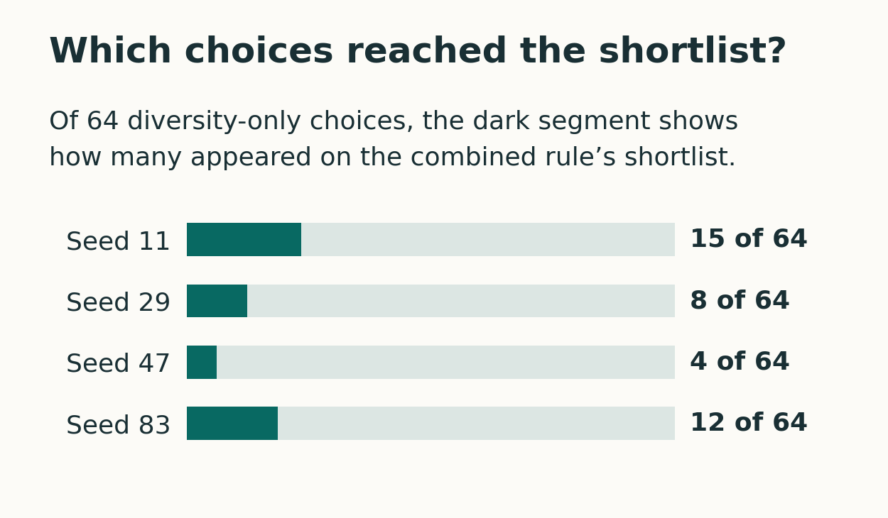

# GFP active learning

When the model could reveal only 64 more green fluorescent protein (GFP) brightness measurements, did it help to narrow its choices first? In four historical runs, the screen kept **4 to 15 of the 64 records** that a diversity-only rule chose. In the run that kept just four, the combined rule still predicted the more mutated examples slightly better after the first batch.

[Read the shortlist case study](experiments/shortlist_review/README.md) · [Explore the four rules](https://thethunda01.github.io/gfp-active-learning/) · [Inspect the four-row results table](experiments/shortlist_review/results/seed_comparison.csv)



**First-round eligibility.** Each run began with 64 labeled records. Of the 2,336 remaining, the combined rule could choose only from a shortlist of 256. The bars show how many diversity-only choices made that shortlist. The [case study](experiments/shortlist_review/README.md#what-happened-to-prediction-error) follows those same runs into their first prediction check.

## Why this project

A model can use its uncertainty to decide which measurement to inspect next. This project tests that idea with fluorescence measurements published by Sarkisyan and colleagues. Each selection rule reveals values that researchers had already measured. The fixed pool makes the decisions inspectable and the comparisons repeatable. [Original study](https://doi.org/10.1038/nature17995) · [Data provenance](docs/data-provenance.md)

## What it does

| Investigation | Question | Evidence |
| --- | --- | --- |
| Original benchmark | Does combined selection improve on random sampling? | [Two-rule learning curves and paired seeds](results/report.md) |
| Four-rule comparison | What happens when the uncertainty and diversity steps are used separately? | [Four policies at the same budgets](experiments/uncertainty_ablation/README.md) |
| First-shortlist review | Which diversity-only choices did the screen leave available? | [Diagram, reconstructed counts and archived error differences](experiments/shortlist_review/README.md) |

All three use the same historical records. Within each seed, the rules begin with the same 64 labels from a pool of 2,400 and finish with 384. Two separate evaluation sets contain 400 nearby sequences and 800 more mutated sequences. The rules never see their brightness measurements during selection or training.

## Quick start

To inspect the results in your browser, [open the four-rule explorer](https://thethunda01.github.io/gfp-active-learning/). It also runs offline if you download [its self-contained HTML file](https://raw.githubusercontent.com/TheThunda01/gfp-active-learning/main/docs/index.html). To rerun the first-screen comparison, use the [case-study commands and platform notes](experiments/shortlist_review/README.md#reproduce-the-comparison).

CI uses Python 3.12. The included 1.3 MB CSV lets the analysis run offline after dependency installation. It requires no account, application programming interface (API) key, graphics processing unit (GPU), or model download.

```bash
python -m venv .venv
# macOS/Linux:
source .venv/bin/activate
# Windows PowerShell instead: .venv\Scripts\Activate.ps1
python -m pip install -r requirements.txt
python -m unittest discover -s tests -v
python -m gfp_active_learning --output-dir reproduced-results
python scripts/check_reproduction.py results reproduced-results
```

The recorded development run took under two minutes on a central processing unit (CPU); runtime depends on the machine and environment. It writes six CSV tables, a run manifest, a plot, and a short [results report](results/report.md). The reproduction check uses strict input hashes and tolerant numeric comparisons; it does not require identical PNG bytes across platforms.

To rebuild the subset from the two pinned public source downloads:

```bash
python scripts/prepare_data.py --download --output rebuilt-data
```

This optional step verifies source and archive-member checksums before matching records. Normal analysis does not download anything. Remove `rebuilt-data` after checking it if you do not want a second data copy.

Audit the saved run (failure returns a nonzero exit status):

```bash
python -m gfp_active_learning.audit --results-dir results --out run-audit.json
```

Export final-budget predictions and check their metrics independently:

```bash
python -m gfp_active_learning.predictions export --results-dir reproduced-results --directory reproduced-results/final-predictions
python -m gfp_active_learning.predictions verify --results-dir reproduced-results --directory reproduced-results/final-predictions
```

These commands use the reproduced run and write its prediction bundle under `reproduced-results/`. Export replaces prediction files at the specified destination; verification replaces its two report files. Choose a separate directory for each run to retain earlier bundles and the checked-in example.

## Example results

At 384 labels, uncertainty-only had the lowest mean prediction error on nearby sequences. Diversity-only had the lowest mean error on the more mutated sequences. The combined rule outperformed random sampling on average on the nearby set and trailed it on the more mutated set.

| Selection rule | Nearby RMSE | More mutated RMSE |
| --- | ---: | ---: |
| Random | 0.7715 | 1.1651 |
| Uncertainty-only | **0.7535** | 1.1897 |
| Diversity-only | 0.7699 | **1.1428** |
| Combined | 0.7570 | 1.1799 |

RMSE measures prediction error on the source log-brightness scale. Lower values mean closer predictions. The table averages four starting seeds on the same evaluation records. Nearby sequences have up to three source substitutions. The more mutated set has four or more. [Explore each seed](https://thethunda01.github.io/gfp-active-learning/) · [Underlying observations](experiments/uncertainty_ablation/results/learning_curves.csv)

### Inspect the paired seeds

The full [four-rule report](experiments/uncertainty_ablation/results/report.md) includes the paired contrasts, variability and learning curves. The original [two-rule seed explorer](docs/seed-explorer.md) lets you follow individual runs across budgets. The [saved-run audit](examples/run-audit.json) checks the acquisition records, and the [final-prediction check](examples/final-predictions/verification.json) reconciles exported predictions to 16 final-budget metric rows.

## Practical use and limitations

Cell-based GFP fluorescence depends on expression (protein production), folding into a three-dimensional structure, and maturation of its light-emitting group, as well as the protein's photophysical properties ([Sarkisyan et al., 2016](https://doi.org/10.1038/nature17995); [Balleza et al., 2018](https://doi.org/10.1038/nmeth.4509)). It does not directly measure intrinsic molecular brightness or general enzyme activity.

The model uses residue composition and mutation count, discarding position-specific information. Its tree disagreement ranks candidates but does not quantify calibrated uncertainty. The fixed measured pool omits prospective assay failures, changing experimental conditions, and unobserved sequence space.

The scientific starting points are [Sarkisyan et al.](https://doi.org/10.1038/nature17995), [TAPE](https://proceedings.neurips.cc/paper/2019/hash/37f65c068b7723cd7809ee2d31d7861c-Abstract.html), and [Greenman et al.'s uncertainty benchmark](https://doi.org/10.1371/journal.pcbi.1012639). This is an independent educational implementation, not a reproduction of their model results. Code is [MIT licensed](LICENSE); the adapted scientific data retain [CC BY 4.0 attribution](DATA_LICENSE.md).

## Documentation

| Guide | What you will find |
| --- | --- |
| [Project context](docs/project-context.md) | Motivation and main themes |
| [Biology and concepts](docs/biology-and-concepts.md) | GFP phenotype and the learning problem |
| [Methods](docs/methods.md) | Features, policies, metrics and limits |
| [Glossary](docs/glossary.md) | Biological, statistical and software vocabulary |
| [Assumptions](docs/assumptions.md) | Design choices, rationales, checks and consequences |
| [Reference audit](docs/reference-audit.json) and [review record](docs/review-2026-10-20.md) | Verified source coverage and corrections |
| [Maintenance review, 21 October 2026](docs/review-2026-10-21.md) | Current source checks, reproduction and remaining work |
| [References](docs/references.md) | Scientific sources |
| [Data provenance](docs/data-provenance.md) | Exact source matching, splits and exclusions |
| [Practical use](docs/practical-use.md) | Audit contract and worked example |
| [Literature review](docs/literature-review.md) | Documented search and appraisal |
| [Related tools](docs/related-tools.md) | Independent tools and conceptual relationships |

## Development and reuse

Run the tests, reproduce the benchmark and compare the outputs before changing the model or policies. The audit is designed for the current fixed seeds, budgets, descriptors and model configuration. A deliberate protocol change needs a new evaluation plan and updated tests. See [CONTRIBUTING.md](CONTRIBUTING.md). No external analysis code was copied.
