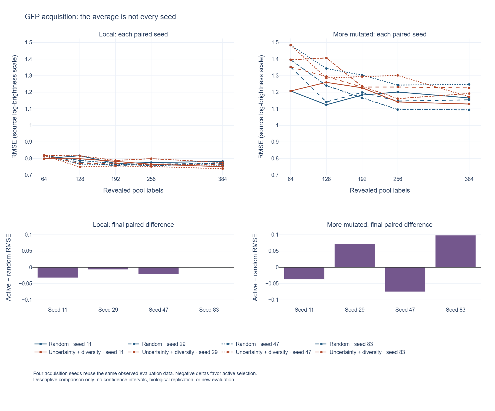

# Inspect the acquisition seeds

The [interactive explorer](figures/seed-explorer/seed-explorer.html) exposes the original two-policy benchmark's individual trajectories and final paired differences. Download the HTML file using GitHub's **Download raw file** control and open it locally; GitHub's file viewer does not execute it. The file includes its plotting library and needs no server or network connection.



Each line is one policy/seed combination. Hover for the exact budget, seed and RMSE. The legend can hide individual trajectories. Both evaluation panels use the same vertical scale. The lower panels subtract random RMSE from uncertainty-plus-diversity RMSE within the same seed at 384 labels: a negative difference favors the active heuristic, and a positive difference favors random.

Four acquisition seeds reuse the same measured evaluation data. They are not biological replicates, confidence intervals, or evidence of a generally superior policy. This view is of the original two-policy results; the separate [four-policy ablation](../experiments/uncertainty_ablation/README.md) remains distinct. Read [Methods](methods.md) for the acquisition and evaluation boundaries.

## Input and output contract

The [builder](../scripts/build_seed_explorer.py) reads `results/learning_curves.csv` and `results/paired_final_differences.csv`; it does not fit a model, reveal additional labels, or modify the saved results. It requires the full 80-row grid, eight final paired comparisons, correct 400/800 evaluation denominators, equal paired initial scores, finite nonnegative RMSE, and agreement between saved differences and the underlying final scores. Missing or duplicate combinations fail explicitly.

Outputs are `seed-explorer.html`, `seed-explorer.png`, and [source-manifest.json](figures/seed-explorer/source-manifest.json) under `docs/figures/seed-explorer/`. The manifest and HTML record the source files' SHA-256 after CRLF-to-LF normalization only. This handles Git's text checkout conventions while retaining all other bytes. It establishes the plot's source identity, not biological validity.

## Regenerate and verify

The data check uses only Python's standard library:

```sh
python scripts/build_seed_explorer.py --check-only
python -m unittest discover -s tests -v
```

For optional rendering, create a separate environment so the core pinned analysis dependencies stay intact:

```sh
python -m venv .venv-visualization
# macOS/Linux: source .venv-visualization/bin/activate
# Windows PowerShell: .venv-visualization\Scripts\Activate.ps1
python -m pip install -r requirements-visualization.txt
python scripts/build_seed_explorer.py
```

The optional pins are Plotly 7.1.0 and Kaleido 1.5.0. The generated HTML retains the embedded Plotly.js MIT license header. PNG export also requires an existing Chrome installation, as described in [Plotly's official static-export guide](https://plotly.com/python/static-image-export/). The recorded rendering used Chrome already installed on the workstation; the builder does not download a browser. Use `--results-dir` for a complete run with the same protocol and `--output-dir` for a separate destination. Generation overwrites only its three named export files; check its exit status before treating a bundle as complete.

Tests include lost pairings, wrong denominators, nonfinite scores, unequal initial scores, and inconsistent saved deltas. Inspect the rendered plots after a tool upgrade; passing table checks alone does not prove correct visual layout.
