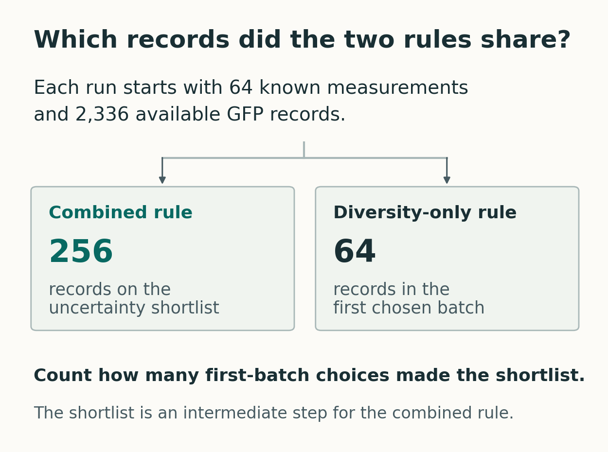
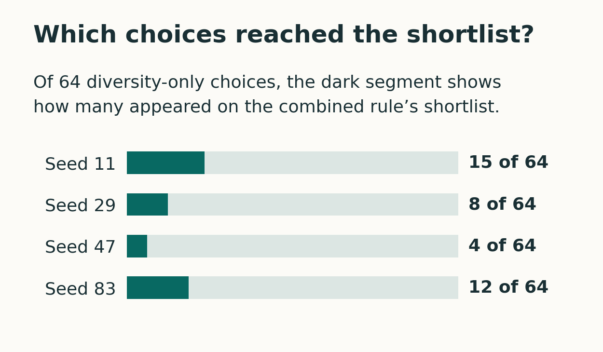
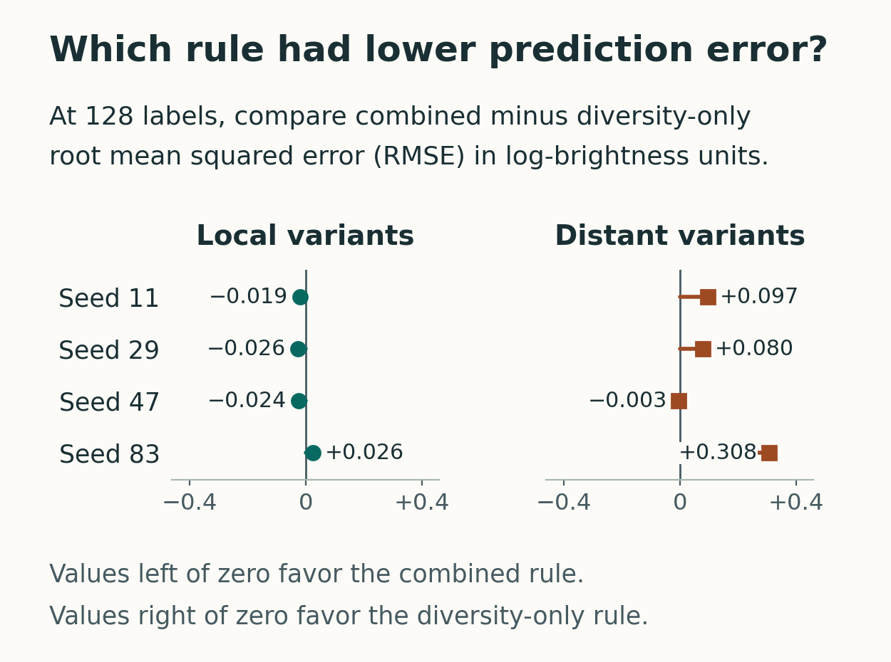

# Which GFP measurements survived the first screen?

Across four runs, the combined rule’s first shortlist kept **4 to 15 of the 64 records** the diversity-only rule chose. The screen narrowed the choices substantially. Its effect on prediction was less clear. In the run that lost the most choices, the combined rule still predicted the more mutated examples slightly better after that batch.

[Explore the four-rule results](https://thethunda01.github.io/gfp-active-learning/) · [Download the four-row analysis table](results/seed_comparison.csv) · [Read the dated question](PLAN.md)

## Where the rules parted ways

The original portfolio benchmark asked which existing measurements helped a model predict green fluorescent protein (GFP) brightness. Each run began with the same 64 measured records for both rules. The diversity-only rule chose its next 64 from all 2,336 remaining records. The combined rule first shortlisted 256 records where the model’s trees disagreed most, then chose 64 from that list. This follow-up asks a neutral question about that first screen. How many of the diversity-only choices were still available to the combined rule?



**Figure 1. The first choice starts from common evidence.** A seed identifies one starting sample. Within a seed, both rules had seen exactly the same brightness measurements before choosing their next batch. Their training histories diverged after that choice.

## Eligibility and selection are different counts



**Figure 2. Most diversity-only choices fell outside the first shortlist.** Each row has the same denominator of 64. The archive contains the choices each rule made. We reconstructed eligibility because the archive did not save the entire shortlist.

| Starting seed | Eligible for the combined rule | Excluded by the screen | Actually chosen by both |
| --- | ---: | ---: | ---: |
| 11 | 15 | 49 | 8 |
| 29 | 8 | 56 | 3 |
| 47 | 4 | 60 | 4 |
| 83 | 12 | 52 | 5 |

For seed 11, the screen left 15 of the diversity-only choices available. The combined rule then chose eight of those 15. The two rules therefore differed both in which records they could choose and in which eligible records they ultimately chose. [Reconstructed counts and archived error differences](results/seed_comparison.csv)

## What happened to prediction error?

After the first batch, both rules had 128 measurements. We compared their root mean squared error (RMSE) on the same two evaluation sets. RMSE measures how far predictions fall from the recorded log-brightness values. Lower values indicate closer predictions.



**Figure 3. Prediction differences after one batch.** Each point shows combined RMSE minus diversity-only RMSE on the source log-brightness scale. Positive values favor diversity-only. Negative values favor combined. The panels share a scale, and each seed uses the same evaluation records as the other seeds.

On the more mutated set, seed 47 had the **fewest eligible choices (4)**, yet combined had slightly lower error (difference **−0.0033**). Seed 83 retained 12 choices and had the largest error increase (**+0.3075**). The comparison establishes that screening restricted eligibility. It does not isolate the effect of the excluded records on error. The second selection step and the particular records used for training also differed.

| Budget and evaluation set | Mean RMSE difference, combined minus diversity-only | Runs with lower combined error |
| --- | ---: | ---: |
| 128 labels · nearby | −0.0108 | 3 of 4 |
| 128 labels · more mutated | +0.1204 | 1 of 4 |
| 384 labels · nearby | −0.0129 | 3 of 4 |
| 384 labels · more mutated | +0.0371 | 1 of 4 |

At 384 labels, each rule had made several further choices using its own training history. The final-budget rows describe where those runs ended. Four starting samples share the same evaluation records, so these are descriptive comparisons. [Per-seed values at both budgets](results/seed_comparison.csv)

## How this relates to the original prediction

The earlier four-rule study asked whether adding the combined rule helped more on distant examples **relative to random selection**. Two seeds favored that prediction and two went the other way. The table above compares **combined with diversity-only** to examine the shortlist. The comparator changes the question. The interactive explorer shows all four policies and the original paired comparison on two fixed sets of 400 nearby and 800 more mutated examples. [Explore the final-budget results](https://thethunda01.github.io/gfp-active-learning/) · [Original fixed plan](../uncertainty_ablation/PLAN.md) · [Four-rule results](../uncertainty_ablation/results/report.md)

## Reproduce the comparison

The audit checks the archived file fingerprints, matches record identifiers, and replays the historical first round. It compares the reconstructed order with **two archived lists** for each seed: the first 64 uncertainty-only choices and the 64 combined choices. Both orders matched all four seeds in the published Linux x86-64 run (Python 3.12.16, NumPy 2.3.5, scikit-learn 1.8.0). The full ranking of 256 was never archived, so this check cannot compare every rank directly with an original file. [Verified Linux run](https://github.com/TheThunda01/gfp-active-learning/actions/runs/44214115090/job/134499528636)

On an Apple Silicon run with the pinned NumPy and scikit-learn versions, both orders matched for seeds 47 and 83 only. The audit leaves exact shortlist counts blank when either order differs. The overlap between the archived first-batch selections and the error differences calculated from the archive are available on both platforms. A blank field means the replay could not establish that count. The earlier final-prediction reproduction test also differed on this Apple Silicon machine, including in the checkout before the follow-up. Linux CI checks that earlier benchmark against its original tolerances.

From the repository root, install the [pinned dependencies](../../requirements.txt) and run:

```bash
python -m experiments.shortlist_review.audit --output reproduced-results/first-shortlist.csv
python experiments/shortlist_review/plot.py --input experiments/shortlist_review/results/seed_comparison.csv --output reproduced-results/shortlist-figures
python experiments/shortlist_review/build_explorer.py --check
python -m unittest discover -s experiments/shortlist_review/tests -v
```

The CSV command expects a fresh output path. The figure command above uses the published Linux results. To inspect a local replay visually, pass its CSV to the same command.

Brandon chose a neutral research question for this follow-up. AI assistance supported the analysis, figures and writing. All fluorescence measurements come from the existing public study. [Sarkisyan et al., 2016](https://doi.org/10.1038/nature17995) · [Data attribution and reuse](../../DATA_LICENSE.md)
