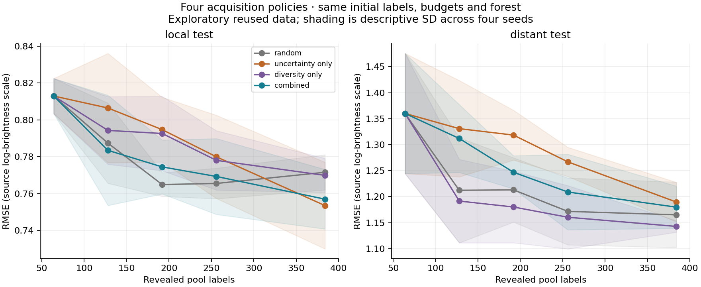

# What did the policy ablation teach us?

The combined policy did **not** perform best on more-distant variants in this fixed exploratory comparison. **Diversity-only** had the lowest mean distant RMSE; **uncertainty-only** had the lowest mean local RMSE. Combining the two heuristics did not guarantee the benefit of either one.

The initial prediction—that the combined policy would perform best at distance—was recorded before the new run in [PLAN.md](PLAN.md). The original random/combined results were already public, so this is a transparent extension on reused outcomes, not a fresh blind test.

## The comparison

All four policies use the same four seeds, the same 64 starting labels within each seed, the same budgets up to 384 labels, and the same coarse descriptors and random forest. The new policies isolate the components of the existing hybrid:

| Policy | Selection rule |
| --- | --- |
| Random | Uniform sampling from the remaining pool. |
| Uncertainty-only | Highest tree-prediction disagreement; no diversity selection. |
| Diversity-only | Greedy maximum minimum Hamming distance across the full remaining pool; no model score. |
| Combined | The unchanged original rule: uncertainty shortlist of four times the batch size, then greedy diversity within it. |

## The result at 384 labels

Lower RMSE is better. Values are mean ± sample SD across four acquisition seeds on the same fixed observations, in the source's log-brightness units.

| Policy | Local RMSE | Distant RMSE |
| --- | ---: | ---: |
| Random | 0.7715 ± 0.0096 | 1.1651 ± 0.0632 |
| Uncertainty-only | 0.7535 ± 0.0235 | 1.1897 ± 0.0380 |
| Diversity-only | 0.7699 ± 0.0093 | 1.1428 ± 0.0111 |
| Combined | 0.7570 ± 0.0162 | 1.1799 ± 0.0406 |

Combined improved on random by 0.0146 RMSE locally, but was worse by 0.0148 distantly. The planned distant-minus-local benefit contrast was **−0.0293** on average. Its sign split two-positive/two-negative across seeds. That is a useful disagreement with the original prediction, not a significance result.

Tree disagreement had substantially weaker rank association with absolute error distantly than locally. For the combined policy, the mean association was **0.5496 locally** and **0.0688 distantly**. Each association was computed within one policy, seed, budget and evaluation role before averaging. This is not calibration or a probability of being wrong.

One plausible follow-up is to inspect whether the uncertainty shortlist excludes candidates that the full-pool diversity rule finds useful. The present result does not prove that mechanism. The model also discards residue position and cannot extrapolate the mutation-count feature beyond the pool range. The scope stays one historical GFP subset, with related sequences and already observed labels.



## Reproduce and inspect

From the repository root:

```sh
python -m unittest discover -s experiments/uncertainty_ablation/tests -v
python -m experiments.uncertainty_ablation
```

The [full report](results/report.md) includes paired seeds and uncertainty/error diagnostics. [Learning curves](results/learning_curves.csv) preserve every seed/budget/policy result; [query history](results/query_history.csv) preserves all 6,144 selected record IDs and revealed labels. [Acquisition overlap](results/acquisition_overlap.csv), [paired differences](results/paired_final.csv), and the [distance contrast](results/distance_benefit_contrast.csv) make the comparisons reconstructable. [Final predictions](results/final_predictions.csv.gz) contain 19,200 evaluation predictions, tree spreads and absolute errors. [Run metadata](results/run_metadata.json) records the fixed plan, split fingerprints, model settings and hashes.

Seven focused tests check component isolation, shared starts, historical selectors, and independence from evaluation/unrevealed outcomes. The full run also verifies that original random/combined acquisition orders and scores reproduce, and that the [original file fingerprints](baseline_files.json) remain unchanged.

This experiment reuses the [original data attribution](../../DATA_LICENSE.md), [measurement background](../../docs/biology-and-concepts.md) and [model limitations](../../docs/methods.md). No new sequences, assays, calibrated uncertainty, or model tuning were introduced.
