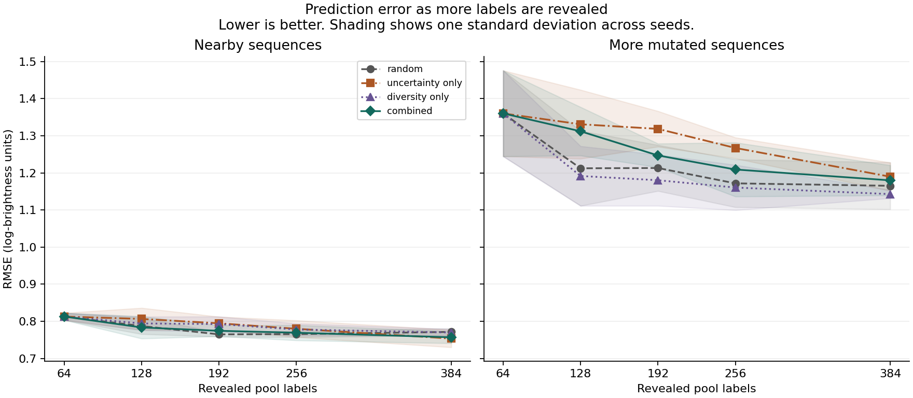

# Does combined selection help more at distance?

The original prediction was that combined selection would help most on more mutated sequences. At 384 revealed labels, each policy was evaluated on the same historical measurements. Lower root mean squared error (RMSE) means the predictions were closer to the recorded log-brightness values.

| Evaluation | Policy | Mean RMSE | SD across seeds |
| --- | --- | ---: | ---: |
| local_test | random | 0.7715 | 0.0096 |
| local_test | uncertainty_only | 0.7535 | 0.0235 |
| local_test | diversity_only | 0.7699 | 0.0093 |
| local_test | combined | 0.7570 | 0.0162 |
| distant_test | random | 1.1651 | 0.0632 |
| distant_test | uncertainty_only | 1.1897 | 0.0380 |
| distant_test | diversity_only | 1.1428 | 0.0111 |
| distant_test | combined | 1.1799 | 0.0406 |

**Lowest distant-set mean RMSE (1.1428)** · diversity only.

## Where did combined selection help?

For each seed, subtract the combined policy’s error from random sampling’s error. A positive benefit means the combined policy predicted more accurately.

The mean benefit of combined selection was larger on the local set. The distant-minus-local contrast averaged **-0.0293** RMSE units. Across 4 seeds the counts were 2 positive, 2 negative, and 0 tied.

| Seed | Local benefit | Distant benefit | Distant minus local |
| ---: | ---: | ---: | ---: |
| 11 | +0.0317 | +0.0367 | +0.0050 |
| 29 | +0.0067 | -0.0719 | -0.0786 |
| 47 | +0.0212 | +0.0748 | +0.0536 |
| 83 | -0.0012 | -0.0985 | -0.0973 |

Each seed reuses the same evaluation measurements. The differences describe this historical benchmark.

## Does tree disagreement track error?

Each cell averages the final-budget Spearman correlation across seeds. Positive values mean that cases with greater disagreement between trees tended to have larger errors.

| Policy | Nearby sequences | More mutated sequences |
| --- | ---: | ---: |
| random | 0.5609 | 0.1138 |
| uncertainty_only | 0.5682 | 0.1048 |
| diversity_only | 0.5924 | 0.1219 |
| combined | 0.5496 | 0.0688 |

The correlations describe how errors rank within each set. They do not measure calibrated interval coverage.

The models use composition and mutation count. The distant set extends beyond the pool’s mutation-count range. The four policies share their initial labels and budgets within each seed.
