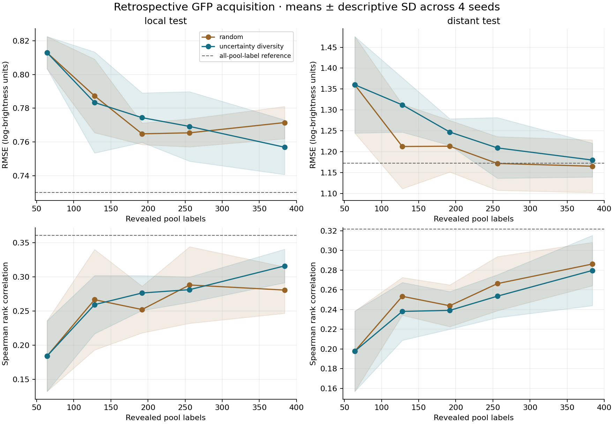

# Retrospective GFP acquisition: current run

All labels already existed before this simulation. Acquisition reveals stored observations; it performs no new experiment and creates no new sequence.

| Evaluation | Policy | Labels | Mean RMSE | Descriptive SD | Mean Spearman |
| --- | --- | ---: | ---: | ---: | ---: |
| local_test | random | 384 | 0.7715 | 0.0096 | 0.2807 |
| local_test | uncertainty_diversity | 384 | 0.7570 | 0.0162 | 0.3160 |
| distant_test | random | 384 | 1.1651 | 0.0632 | 0.2863 |
| distant_test | uncertainty_diversity | 384 | 1.1799 | 0.0406 | 0.2797 |

Shading is one descriptive SD over four random seeds, not a confidence interval. Policies share each seed’s initial labeled set. Local and distant evaluation sequences remain outside the acquisition pool.

The dashed reference uses all 2,400 pool labels with the same model family. It is not an attainable guarantee or a mathematical performance bound.

The distant split has at least four source-reported substitutions; pool/local-test sequences have at most three. Nearby sequences can still occur across this boundary; see `distance_audit.csv`. Residue composition discards position information and the forest cannot extrapolate the mutation-count feature beyond its training range.

A favorable seed or average does not establish a reliable laboratory advantage. Tree disagreement is not calibrated uncertainty, and these measured-pool results do not include assay costs, failures, new noise, or changes in biology. See [methods](../docs/methods.md).
